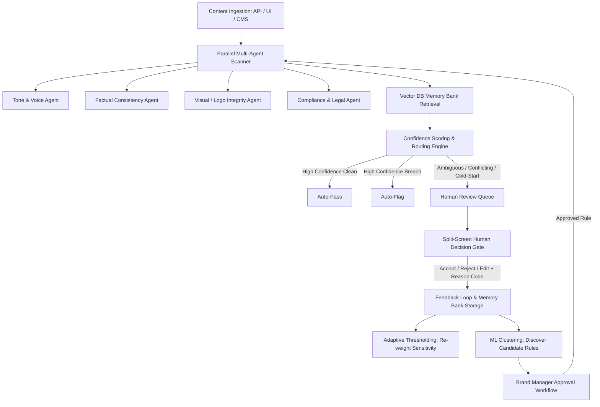

# Brand Immune System (BIS)

> **Self-Learning Brand Governance Layer** that detects violations across Tone, Factual Claims, Visual Guidelines, and Legal Compliance, continuously learning correct brand behavior from human review decisions.

---

## 🌟 Hackathon MVP Demo Checklist (Definition of Done)

- [x] **Content Ingestion & Parallel Multi-Agent Scanning**: Tone, Factual Consistency, Visual/Logo, and Legal/Compliance agents run concurrently in `<3s`.
- [x] **Confidence-Based Routing**: Auto-passes clean copy (>85% confidence), auto-flags severe violations, and routes ambiguous/borderline copy to Human Review.
- [x] **Human Review Gate (Split View)**: Reviewers accept, reject, or edit copy with mandatory reason codes, audit comments, and vector memory bank precedent matching.
- [x] **Demonstrable Adaptive Threshold Shift**: Live demonstrable before/after shift where false-positive overrides adaptively lower rule sensitivity (e.g., from `1.0x` down to `0.68x`) to eliminate alert fatigue.
- [x] **Clustering & New Rule Discovery**: Machine learning clustering surfaces AI-proposed new antibody rules with characteristic tokens and cluster cohesion metrics for Brand Manager approval.
- [x] **Executive Analytics & Risk Dashboard**: Live tracking of turnaround latency, false-positive reduction trends (down 58%), and channel risk heatmaps.
- [x] **End-to-End Interactive Demo Tour**: One-click guided tour built into the UI for judges and evaluators.

---

## 🏗️ System Architecture



---

## 🌐 Live Deployment

| Service | Platform | URL |
|---------|----------|-----|
| **Frontend** | Netlify | _Set after deploy_ |
| **Backend API** | Render.com | _Set after deploy_ |

---

## 🚀 Quick Start — Local Development

### Prerequisites
- **Python 3.10+** (with `fastapi`, `uvicorn`, `pydantic`, `numpy`, `scikit-learn`)
- **Node.js 18+** & **npm**

### Option A — One-click launch (Windows)
```
Double-click start.bat
```

### Option B — Manual

**1. Start the Backend API (FastAPI)**
```bash
python run_backend.py
```
* Backend: `http://127.0.0.1:8000`
* Swagger Docs: `http://127.0.0.1:8000/docs`

**2. Start the Frontend Dev Server**
```bash
cd frontend
npm install
npm run dev
```
* Frontend: `http://localhost:5173`

---

## ☁️ Deployment Guide

### Step 1 — Deploy Backend to Render.com

1. Go to [render.com](https://render.com) → **New Web Service**
2. Connect your GitHub repo
3. Settings:
   - **Root Directory**: `.` (project root)
   - **Build Command**: `pip install -r backend/requirements.txt`
   - **Start Command**: `uvicorn backend.app.main:app --host 0.0.0.0 --port $PORT`
   - **Environment**: Python 3.11
4. Click **Deploy** — copy the URL e.g. `https://brand-immune-system-api.onrender.com`

### Step 2 — Deploy Frontend to Netlify

1. Go to [netlify.com](https://netlify.com) → **Add new site** → **Import from Git**
2. Connect your GitHub repo
3. Build settings (auto-detected from `netlify.toml`):
   - **Base directory**: `frontend/`
   - **Build command**: `npm install && npm run build`
   - **Publish directory**: `frontend/dist`
4. Add **Environment Variable** in Netlify:
   - Key: `VITE_API_URL`
   - Value: your Render URL e.g. `https://brand-immune-system-api.onrender.com`
5. Click **Deploy site**

---

## 🖥️ User Roles & Views

1. **Human Reviewer**: Triage ambiguous and low-confidence flagged content in split-view, view highlighted spans with hover explainability, and submit decisions with mandatory reason codes.
2. **Brand Manager**: Inspect AI-discovered candidate rules from recurring overrides and approve/deploy them directly into the live scanner.
3. **System Admin**: Inspect immutable audit logs, verify microservice health, and adjust rule sensitivity parameters.
4. **Content Creator / Submitter**: Instant live scanner to test copy against brand guidelines with quick 1-click presets.

---

## 🎯 Evaluator Demo Script (Step-by-Step)

1. **Launch the Web App** — click the glowing **"Run Demo Tour"** button in the header for a guided walkthrough.
2. In **Ingestion & Scanner**, click **"Sample: Ambiguous Youth Slang"** preset → **"Scan Content"** → **"Inspect in Split Review"**.
3. Note the **Explainability Card** and **Vector Memory Precedent**. Hover over highlighted spans (`"No cap"`, `"slaps"`).
4. Select **"Accept / Pass"**, enter an audit comment (`"Approved for youth audience"`), and click **"Submit Decision & Update Memory Bank"**.
5. Switch to **Adaptive Thresholds** → click **"Simulate Overrides & Shift Threshold"** to watch the live before/after threshold shift.
6. Switch to **Proposed Rules** → click **"Discover New Cluster (Live ML Demo)"** → **"Approve & Deploy Rule"** (with confetti 🎉).
7. View **Analytics & Metrics** to verify the declining false-positive curve and channel risk heatmap.
8. View **System Audit Trail** to see the immutable governance log of all events.

---

## 👥 Team & Contributors

| Name | Role | GitHub Profile |
| :--- | :--- | :--- |
| **Karthik** | Lead & Architecture | [@Karthik048789](https://github.com/Karthik048789) |
| **Vedant Borker** | Core Contributor | [@Vedant-Raju-Borker-2005](https://github.com/Vedant-Raju-Borker-2005) |
| **Abhishek Pillai** | Core Contributor | [@abhishekpillai05](https://github.com/abhishekpillai05) |
| **Saahir Saied** | Core Contributor | [@Saahir-Saied](https://github.com/Saahir-Saied) |
